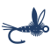

# Flybench

Animated, step-by-step 3D fly tying instructions. Each fly is a recipe written in
KDL (`patterns/*.kdl`). The app validates it, simulates the tying sequence and
renders a scrubbable 3D animation together with written steps, a materials list and
the pattern's history, fishing notes and sources. It is a fully static site.

The front page is the gallery, with a fly of the day and a way in for beginners: search
by name, insect or material, and filter by type, insect, difficulty, fish, season and
materials. Every page has its own address, and so do filtered galleries and pattern steps
(`/?imitates=caddis`, `/fly/elk-hair-caddis/?step=7`). Old `#/` links redirect.

Techniques (`/techniques/`) explain each thing a fly is made of, with a looping 3D
example taken from a real pattern; every step of every pattern links to its technique.
The learning path (`/learn/`) orders the catalog so each fly adds only a few new
techniques.

Personal features live in the browser (no account, no sync): a fly box (`/box/`) with a
shopping list of what its flies still need, a materials inventory (`/materials/`) that
drives "Tie with what I have" in the gallery, a tying log (`/log/`, "I tied this" on every
pattern) with learning-path progress and the techniques practised, and vise mode on pattern
pages for following along at the bench. "Try other colours" on a pattern page changes any
part's colour: the 3D fly, the steps and the dressing follow, the colours go into the
address (`?colours=body:yellow`), and a variation can be saved to the fly box. A fly box for
a trip (`/trip/`) suggests a dozen patterns and their sizes for a region, month, water and
fish, from the hatch calendar. "Build a fly" (`/build/`) makes a fly of your own, from a
bare hook or a copy of a pattern: hook, thread, materials and steps chosen from menus, with
the 3D fly, the written steps and the tying rules (in the page's language) following each
change. Own flies are saved in the browser, appear in the gallery, the fly box, the tying
log and the trip box, can be downloaded as a recipe file, and shared as a link that carries
the whole fly after the `#`. The built site installs as an app and works offline after
the first visit.

The site is in English, Swedish (`/sv/`) and German (`/de/`), every page prerendered in each.
The step texts and the dressing are generated in each language from a glossary of tying words
with their grammatical forms (`glossary/`), the prose people wrote is translated beside the
patterns (`translations/`); the Swedish and German texts are drafts until reviewed. See
[docs/translating.md](docs/translating.md) and [docs/glossary.md](docs/glossary.md).

Product decisions and the milestone plan: [docs/product-plan.md](docs/product-plan.md).

## Run

Requires Node 24 or later (`.nvmrc`) and pnpm, in the version `package.json` names under
`packageManager`: `corepack enable` sets it up, or install pnpm and it switches itself.

```sh
pnpm install
pnpm dev           # http://localhost:5173
pnpm studio        # the authoring studio (dev server only), /studio.html
pnpm test          # recipe parsing/validation and simulation tests
pnpm typecheck
pnpm build         # type-check, production build and one HTML file per page into dist/
pnpm render:catalog  # gallery images and material swatches into public/renders/ (commit them)
pnpm render:water  # path-traced stills of every fly and natural in the river into public/renders/water/ (commit them)
pnpm render        # render finished flies to .cache/renders/ (headless Chromium)
pnpm refcheck      # contact sheets: render on a gape grid next to reference photos
pnpm watercheck    # water stills next to photos of real flies and insects on and under water
pnpm icons         # app icon PNGs from public/icons/*.svg
```

Viewer controls: drag to orbit, scroll or pinch to zoom, right-drag to pan.
Space plays and pauses, ← and → step back and forward, Home goes back to step 1 (or hold the
previous-step button). In vise mode Page Down and Page Up do the same as → and ←, for a
page-turner pedal or presentation clicker. The step bar under the view has a segment per step: tap one to go to
it, drag along it to scrub. Click a step in the list to play just that step. On a touch screen
one finger scrolls the page and two fingers turn and zoom the fly. "Proportions" shows the gape
grid and each part's measurements; "Print recipe card" prints the dressing and the steps
with a picture of each. "In the water" shows the finished fly in a river where it fishes (on
the surface, in the film, just under or deep), from above as the angler sees it or from below
as a trout does: first a path-traced picture, then, with "Explore in 3D", the live river with
reflections, refraction, Snell's window and a photoscanned gravel bed. The fly is tied on a
tippet with an improved clinch knot, rests on its hackle and tail tips (a sunk one hangs on the
tippet), looks wet, and dents the film; the dents and its shadow show on the stones, and
capillary ripples, sun glints and drifting specks make the surface read as water. A slow
device, a data saver or reduced motion gets the drawn water instead, from the side or from
below. "Still water" stops the motion. The naturals' pages show each natural in the river the
same way, standing on its feet, resting its body on the film or spent in it (`sits`).
Stepping or playing goes back to the vise. A link keeps the step and the hook size (`?step=7&size=16`).

Rendering uses the GPU through Vulkan in headless Chromium when there is one, and
falls back to software rendering (SwiftShader, much slower) when there isn't;
`FLYBENCH_SOFTWARE_RENDER=1` asks for software rendering directly.

## Adding a pattern

The easiest way is the authoring studio (`pnpm studio`): pick a pattern or a natural, or
start a new one, and edit it either as KDL text, with problems listed as you type (click one
to jump to its line), or through a form built from the schema: sliders and numbers with their
ranges, menus, colour pickers, and list items to add, reorder and remove. The form writes
into the text in place, so comments, sources and formatting stay as they are. Beside it the
fly appears in 3D on a gape grid, step by step (a natural on a grid in tenths of its body
length, or in the realistic river), with the reference photos to compare. Save writes to
`patterns/` or `naturals/`. The studio exists only on the dev server, which only accepts its
requests from this machine; the built site doesn't include it.

Or write a new `patterns/<id>.kdl` by hand and it gets picked up automatically. Materials come
from the catalog in `src/recipe/materials.ts`; add new ones there. The test suite
loads every pattern file, so `pnpm test` reports recipe errors with line numbers.
Problems in pattern files also show in a banner in the dev server. Then run
`pnpm render:catalog` and `pnpm render:water` and commit the images they write to
`public/renders/`; they only re-render patterns whose recipe or rendering code changed
(`render:water` path traces, tens of seconds a picture, and fetches its 2k panorama and
gravel from Poly Haven into `.cache/env/` the first time). The format is
described in [docs/recipe-schema.md](docs/recipe-schema.md), and the authoring procedure
(research, proportions, checks) in [docs/authoring-patterns.md](docs/authoring-patterns.md).

To check proportions, list photos of the finished fly under `references` in the recipe
and run `pnpm refcheck <id>`. It writes `.cache/refcheck/<id>.png`: the fly from
the side on a grid in gape units, the recipe's proportions, and the photos. Read the
ratios off the photos relative to the hook gape and adjust the recipe. The photos stay
in `.cache/` and are never committed, and the build leaves the `references` blocks out
of the published site. Naturals work the same way (`pnpm refcheck mayfly-dun`), on a grid in
tenths of the body length.

## Layout

```
patterns/          fly recipes (KDL)
naturals/          the insects, shrimps and fish the flies imitate (KDL), with hatch months
glossary/          Swedish and German tying words with their grammatical forms (KDL)
translations/      translated prose of patterns and naturals (KDL), per language
docs/              the recipe schema, how to research and write a pattern, translating, the product plan
src/recipe/        KDL → object mapping, Zod schema, materials catalog,
                   semantic and catalog-level validation
src/tying/         hook models and the tying simulation: recipe → timeline of
                   geometry pieces (plain data, no three.js)
src/render/        three.js scene built from the timeline; real/ the realistic river (water
                   shader, photoscanned gravel, panorama) and the build-time path tracer
src/i18n/          languages: the interface's words, the glossary and grammar, prose translations
src/catalog/       catalog search and wording, and the site's pages with their titles,
                   descriptions and text for the build (plain logic, tested in Node)
src/edit/          editing recipes, shared by the studio and the fly builder: KDL edited in
                   place, forms from the schemas, recipes written as KDL, visitors' own flies
                   and their share links (plain logic, tested in Node)
src/ui/            React UI: gallery, pattern page, viewer, fly builder, theme, routing
src/studio/        the authoring studio (studio.html, dev server only)
public/renders/    rendered gallery images, material swatches and water stills (generated, committed)
public/env/        the realistic water's river panorama and gravel (Poly Haven, CC0)
public/logo.svg    the logo (also the header mark); favicon.svg is a simplified version
                   for small sizes, and public/icons/*.svg the app icons (pnpm icons)
render.html        dev-only page that scripts/ drive to render a finished fly
scripts/           authoring tools: render, render-catalog, render-water, refcheck, the
                   dev-server plugin that lets the studio read and save patterns,
                   the build plugin that leaves reference photos out, the app
                   icons, and prerender (the HTML file and preview picture for each page)
.github/workflows/ deployment to GitHub Pages
```

The scene is a pure function of time: `FlyScene.setTime(t)` shows exactly what
the timeline says for `t`, so scrubbing and replaying need no extra state.

## Hosting

The site is published at <https://flybench.ebner.se> on GitHub Pages by
`.github/workflows/deploy.yml` on every push to `main`. One-time setup:

- Repository Settings > Pages: Source "GitHub Actions", custom domain `flybench.ebner.se`,
  Enforce HTTPS once the certificate is issued.
- DNS (Cloudflare, ebner.se): a CNAME record `flybench` → `ebner.github.io`, DNS only (not
  proxied), so GitHub can verify the domain and issue the certificate. Verifying `ebner.se`
  under the account's Settings > Pages adds a TXT record and protects the subdomain from takeover.

With a custom domain no CNAME file is needed in the repository; the workflow takes the
address from Pages. `pnpm build` takes two settings from the environment, which the
workflow fills in:

- `BASE_PATH`: where the site lives on its host, `/flybench/` for the project site or `/`
  on a custom domain (default `/`).
- `SITE_URL`: the host's address, for canonical links, link-preview pictures and
  `sitemap.xml`. Without it the build leaves those out.

After `vite build`, `scripts/prerender.ts` writes an HTML file for every page (each
pattern, technique and section) with its own title, description and preview picture, and
the page's text for search engines and readers without JavaScript. The app replaces that
text when it starts. `404.html` covers any other address.

## Licence

The code is MIT ([LICENSE](LICENSE)). The pattern texts, renders, logo and docs are
CC BY 4.0 ([LICENSE-CONTENT.md](LICENSE-CONTENT.md)). Reference photos, cited sources
and the fonts belong to their owners and aren't covered by either.
